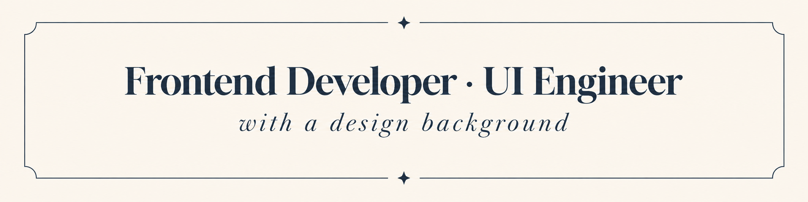

  

<h1 align="center">Jaspreet Singh</h1>
<h3 align="center">Web Designer &amp; Frontend Developer | Mohali, India</h3>

  I design websites in Figma and Photoshop, then build them with Shopify, WordPress, React and Next.js. 
  6+ years &middot; 25+ live client sites &middot; Open to full-time roles

  
  
  
  

---

## About

- Web Designer (Sept 2020 - June 2025) and Frontend Developer (July 2025 - present) at **Tech Prastish Software Solutions**, Mohali.
- I design in Figma, then build responsive sites and storefronts in **Shopify (Liquid), WordPress and BigCommerce**.
- I build component-based interfaces in **React, Next.js and TypeScript**, with GSAP for motion.
- I also make web banners and social creatives in Photoshop and Figma.
- I use Claude and Figma MCP to speed up first drafts, and review every output by hand.

---

## Skills

**Design**

**E-commerce and CMS**

**Frontend**

**React**

**Tools**

---

## Selected projects

| Project | What it is | Stack |
|---|---|---|
| **JessaKae** | Responsive fashion storefront with visual-storytelling layouts | Shopify |
| **LumaFrames** | Photo-frame store with reusable filter and gallery components | Next.js, TypeScript, Tailwind CSS |
| **TaskFlow** | Task dashboard with routing, a task table and a live chart | React, React Router, Recharts |
| **Client work** | 27 live client sites across fashion, e-commerce and industrial brands | Shopify, WordPress, BigCommerce |

See all of it on my [portfolio](https://designwork-eight.vercel.app/).
